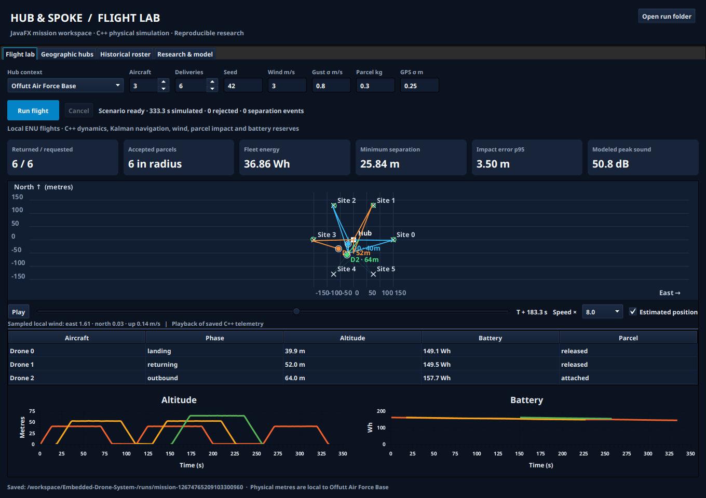

# USTRANSCOMM hub-and-spoke flight lab

The uploaded JavaFX logistics project now runs the C++ drone simulator. Choose a hub and scenario, run a fleet mission, then play back computed trajectories alongside estimated positions, parcel impacts, altitude, battery use, separation, and modeled sound. The geographic globe and historical roster from the Java template remain available in separate tabs.



## Download to your Windows computer

On [GitHub](https://github.com/tmarsoon/Embedded-Drone-System-), select **Code → Download ZIP**, or use the [main-branch ZIP](https://github.com/tmarsoon/Embedded-Drone-System-/archive/refs/heads/main.zip). In File Explorer, right-click the downloaded ZIP and select **Extract All**. Move the extracted project folder into `C:\Users\antho\OneDrive` if that is where you want to keep it. Build and run from the extracted folder containing `pom.xml`.

This is a source project. The Java application and native executable are built together; opening a source file or the ZIP does not start the application.

## Build and run on Windows

Install JDK **21**, Apache Maven **3.9+**, CMake **3.16+**, and Visual Studio 2022 Build Tools with **Desktop development with C++**. Ensure `java`, `mvn`, and `cmake` are on your PATH; set `JAVA_HOME` to the JDK directory. Maven downloads the matching JavaFX libraries, so a separate JavaFX SDK is unnecessary. Python 3 is optional for additional native CLI checks and research experiments.

Open PowerShell in the extracted project folder:

```powershell
powershell -ExecutionPolicy Bypass -File .\scripts\build.ps1 -Test
powershell -ExecutionPolicy Bypass -File .\scripts\run.ps1
```

The execution-policy setting applies only to that PowerShell process. The build script builds C++ with CMake and runs native and Java tests; the run script opens JavaFX. Linux builds and the desktop window were exercised in the cloud workspace. Windows CI is included, but Windows execution was not available in that workspace.

For Eclipse, import **Existing Maven Projects** and select this folder and a Java 21 JDK. Maven replaces the old machine-specific JavaFX and JSON JAR paths. Build `native/` before launching. `application.Launcher` is the entry point; `mvn javafx:run` supplies the required runtime options.

## Build and run on Linux

Use JDK 21, Maven 3.9+, GCC with C++17, GNU Make, and Python 3. JavaFX requires a desktop display and the platform GTK/OpenGL runtime.

```sh
bash scripts/build.sh
make test
bash scripts/run.sh
```

A CMake alternative is:

```sh
cmake -S native -B native/build -DCMAKE_BUILD_TYPE=Release
cmake --build native/build --parallel 4
ctest --test-dir native/build --output-on-failure
mvn -B -C verify
mvn javafx:run
```

Use one build system per native build directory. After using CMake, keep using CMake or remove only the generated `native/build` directory before switching to GNU Make. The Java JAR is not a self-contained installer; use the launch commands above.

## Use the application

1. In **Flight lab**, select a hub, aircraft count, deliveries, seed, wind, gusts, parcel mass, and GPS noise. Select **Run flight**. Computation runs in a background task and can be cancelled.
2. Use **Play**, the time slider, and playback speed to inspect saved native telemetry. Charts show complete mission histories; the map and aircraft table follow the selected playback time. Summary cards describe the completed scenario. Estimated position can be overlaid on actual position.
3. **Geographic hubs** retains the original Earth and galaxy textures and four template locations, with selectable markers, drag rotation, and zoom. Selecting a hub updates the flight context.
4. **Historical roster** searches all 3,473 supplied public historical records. These provide historical context; they are not flight demand, live personnel, or aircraft payload assignments.
5. **Research & model** displays measured questions and answers. **Open run folder** opens current outputs in your local file explorer.

Each run gets a new `runs/mission-*` directory containing the exact command, native JSON, telemetry CSV, logs, and a geographic report. Existing run files are preserved. Playback shows computed telemetry. A hub supplies the origin for local east/north/up simulation; changing hubs does not supply measured weather, terrain, or worldwide aircraft dynamics.

## Algorithms and physical scope

| Component | Implementation |
| --- | --- |
| Flight and payload | Three-dimensional point-mass forces, RK4 integration, drag, parcel release, ground-event impact solve |
| Wind | Seeded Ornstein–Uhlenbeck gusts, mean wind, altitude shear, forecast bias |
| State estimation | Six-state position/velocity Kalman filter, accelerometer prediction, noisy/intermittent GPS, Joseph covariance update |
| Control | Mass-aware position/velocity cascade, bounded thrust/acceleration, braking constraint, integral anti-windup |
| Planning | Finite A* search with best-cost tracking and inflated no-fly columns; no raw owning parent pointers |
| Fleet | FIFO jobs, altitude lanes, exclusive hub-column reservations, waiting-arrival priority, separation monitoring |
| Energy and sound | Power/energy estimate, conservative launch/return reserve, simplified acoustic intensity/exposure |
| Research | Seeded Monte Carlo comparisons, quantiles, run-level mean confidence intervals, reproducibility manifests |
| Java/C++ boundary | Direct process arguments, cancellation/timeouts, strict versioned JSON/CSV validation, local geographic projection |

The aircraft is a point mass with commanded thrust. Full six-degree-of-freedom rotor/attitude dynamics, wakes, terrain, realistic airspace traffic, calibrated acoustics, and learned maintenance prediction are not included. This runnable research model has software and numerical checks; flight accuracy needs calibration against independent aircraft, weather, sensor, payload, and acoustic measurements.

## Research questions and answers

Read [the 12 measured questions and answers](native/docs/RESEARCH_ANSWERS.md), [physical assumptions](native/docs/MODEL.md), and [integration/validation details](docs/INTEGRATION.md). The questions were inferred from the requested scope; they are not official Argonne requirements.

The reference study contains **13 scenarios × 30 seeds**, plus two deterministic timestep checks. Baseline: 180/180 requested missions returned and landed parcels within 5 m, pooled impact p95 **3.69 m**, mean fleet energy **37.25 Wh**, and zero recorded separation-threshold events. Strong wind and biased forecasts produce visible failures and misses. These numbers describe this model and its configurations.

To reproduce from this project root:

```sh
python3 native/tools/research.py --binary native/build/drone_sim --output runs/research --runs 30
```

On Windows use `native/build/Release/drone_sim.exe` after a Visual Studio CMake build. Matplotlib is optional for plots. Reference data in `native/examples/research/` were generated before moving the same native source into this layout; manifests preserve the original paths and hashes.

The native CLI exposes additional parameters including no-fly regions, forecast bias, dropout, battery capacity, and Monte Carlo repetitions:

```sh
native/build/drone_sim --help
native/build/drone_sim --runs 30 --wind 8 --gust 1.5 --output runs/windy
```

For a headless run through the same Java/native bridge as the desktop:

```sh
mvn -q exec:java -Dexec.mainClass=integration.IntegratedCli
```

Exit code zero means an execution completed. Inspect requested, rejected, delivered, returned, accepted, separation, and timeout fields to judge the scenario outcome.

## Verification and source layout

The Linux workspace passed **28 native test groups**, including 41,472 planner comparisons against independent BFS, native CLI/file checks, GNU Make and CMake builds, and **18 Java tests**. Java tests execute the actual C++ binary and check geographic conversion, CSV/schema validation, cancellation/timeouts, and data loading. The desktop smoke runs the real UI-to-native path and verifies six returns and six accepted parcels before saving the screenshot. The unchanged native engine also passed ASan/UBSan before integration. See [the validation record](docs/INTEGRATION.md).

```sh
# Headless Linux UI verification needs Xvfb, xauth and Mesa/OpenGL:
bash scripts/smoke-ui.sh
# Native memory/undefined-behavior checks (GCC/Linux):
make sanitize
```

| Path | Contents |
| --- | --- |
| `src/application/` | JavaFX dashboard, globe, roster, retained application components/resources |
| `src/integration/` | Process bridge, schema reader, telemetry/mission records, hub catalog, headless launcher |
| `src/militarylogistics/` | Retained Java template demonstrations; default flight lab uses C++ dynamics |
| `native/Embedded Drone System/` | Complete C++ model and CLI |
| `native/tests/`, `test/` | Native and Java verification |
| `native/docs/`, `native/examples/research/` | Model, research answers, raw results, figures and manifests |
| `scripts/`, `.github/workflows/` | Builds, desktop smoke, Linux/Windows CI |
| `original-java-sha256.json` | Uploaded Java source/resource inventory before integration |

All 16 original Java source paths are retained, with the entry point and selected data/logging components improved. Original Java orbit/response demonstrations remain for reference and are not used as the flight engine. Generated class files, executables, historical troop/simulation logs, and run outputs are excluded from source control. The original report is retained under `native/`.
