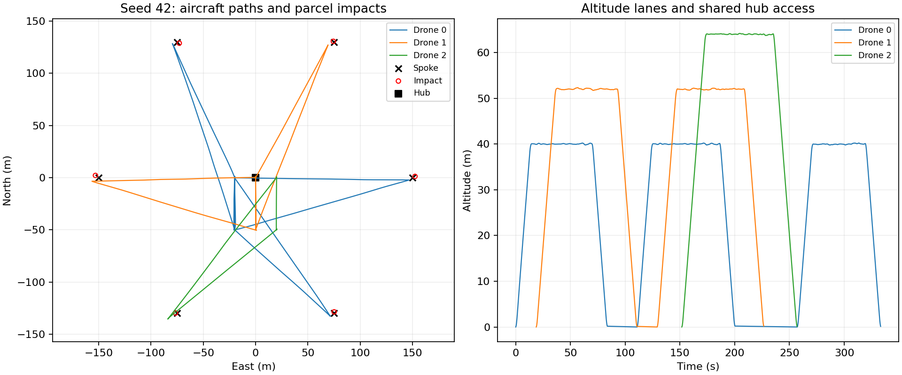
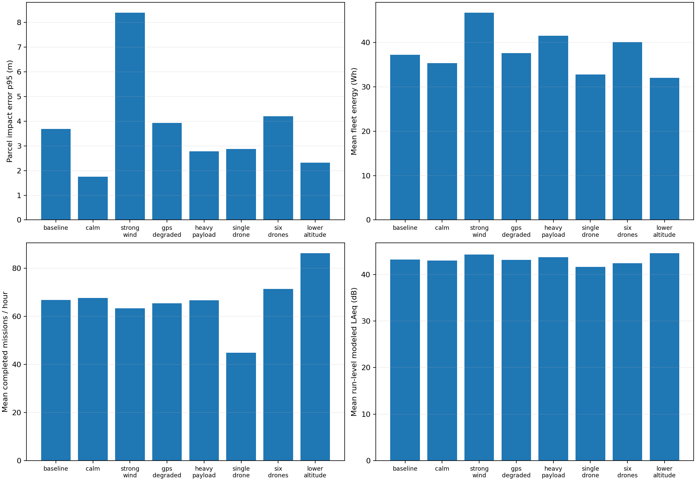

# Hub-and-spoke drone simulation: measured research answers

These are candidate research questions inferred from the requested hub-and-spoke drone simulation. They are not official Argonne requirements or statements from Argonne. Answers below were computed from the runnable C++ model; they do not establish field performance.

Each main scenario uses 30 seeded repetitions, seeds 42–71. The baseline has 3 aircraft, 6 parcel requests, 150 m spokes, cruise lanes beginning at 40 m with 12 m spacing, 3.00 m/s surface wind, and 0.30 kg parcels. The step is 0.100 s.

## Measured scenario results

Counts are totals across repetitions. Completed means parcel impact and aircraft return; delivered means a parcel reached the ground, which can still miss the acceptance radius. In-radius is measured against all requested jobs, including rejected or failed jobs. Energy is the mean total fleet energy per repetition. Impact percentiles are conditional on parcels that impacted; omitted impacts are not assigned zero error.

| Scenario | Requested / delivered / completed / in-radius | In-radius % | Energy mean Wh | Impact p50 / p95 m | Completed/h | Mean LAeq dB | Min separation m | Events / timeouts |
|---|---:|---:|---:|---:|---:|---:|---:|---:|
| baseline | 180 / 180 / 180 / 180 | 100.0% | 37.25 | 1.64 / 3.69 | 66.83 | 43.23 | 25.70 | 0 / 0 |
| calm | 180 / 180 / 180 / 180 | 100.0% | 35.33 | 1.25 / 1.76 | 67.62 | 42.99 | 26.21 | 0 / 0 |
| strong_wind | 180 / 169 / 169 / 134 | 74.4% | 46.72 | 3.15 / 8.40 | 63.30 | 44.26 | 24.85 | 0 / 0 |
| forecast_bias | 180 / 180 / 180 / 102 | 56.7% | 42.69 | 4.55 / 8.87 | 63.43 | 43.66 | 25.83 | 0 / 0 |
| gps_degraded | 180 / 180 / 180 / 178 | 98.9% | 37.56 | 1.71 / 3.93 | 65.38 | 43.17 | 25.47 | 0 / 0 |
| heavy_payload | 180 / 180 / 180 / 180 | 100.0% | 41.48 | 1.59 / 2.78 | 66.60 | 43.72 | 25.95 | 0 / 0 |
| single_drone | 180 / 180 / 180 / 180 | 100.0% | 32.78 | 1.50 / 2.87 | 44.84 | 41.61 | n/a | 0 / 0 |
| six_drones | 180 / 180 / 180 / 176 | 97.8% | 40.10 | 2.10 / 4.20 | 71.41 | 42.45 | 12.13 | 0 / 0 |
| busy_hub | 900 / 900 / 900 / 890 | 98.9% | 195.21 | 1.86 / 3.83 | 70.48 | 44.20 | 12.63 | 0 / 0 |
| lower_altitude | 180 / 180 / 180 / 180 | 100.0% | 32.00 | 1.13 / 2.32 | 86.19 | 44.55 | 13.74 | 0 / 0 |
| no_fly | 180 / 180 / 180 / 176 | 97.8% | 48.49 | 2.26 / 4.76 | 62.49 | 43.99 | 11.82 | 0 / 0 |
| battery_limit | 180 / 0 / 0 / 0 | 0.0% | 0.00 | n/a / n/a | 0.00 | n/a | n/a | 0 / 0 |
| weather_limit | 180 / 0 / 0 / 0 | 0.0% | 0.00 | n/a / n/a | 0.00 | n/a | n/a | 0 / 0 |

Exact configurations, raw outcomes, and commands accompany the report; scenario names are labels, not claims of general operating limits.

## Questions and answers

### 1. What hub throughput does the fleet achieve, and does adding aircraft help?

The baseline completed 180/180 requested missions and averaged 66.83 completed missions/hour. One aircraft averaged 44.84/hour; six averaged 71.41/hour. With 30 queued requests per run, the busy-hub case completed 900/900 and averaged 70.48/hour. The model serializes takeoff and landing corridor ownership and gives each aircraft an altitude lane. This is finite-workload throughput, not a measured steady-state arrival capacity or an optimized fleet size.

### 2. How accurately does a parcel reach a spoke?

Baseline parcels had conditional median error 1.64 m, p95 3.69 m, and pooled mean 1.80 m over 180 impacts. 180/180 requests (100.0%) landed within the configured 5.00 m radius. Release offsets are computed with the same ballistic drag equations using forecast wind; the actual parcel experiences the evolving wind field and inherits aircraft velocity. Parcel delivery and safe aircraft return are reported separately.

### 3. What changes when wind or wind forecasts are worse?

- `calm`: p95 impact error 1.76 m; in-radius 180/180; mean energy 35.33 Wh; rejected launches 0; emergency returns 0; timeouts 0.
- `strong_wind`: p95 impact error 8.40 m; in-radius 134/180; mean energy 46.72 Wh; rejected launches 11; emergency returns 0; timeouts 0.
- `forecast_bias`: p95 impact error 8.87 m; in-radius 102/180; mean energy 42.69 Wh; rejected launches 0; emergency returns 0; timeouts 0.

The wind model combines a directional mean, altitude shear, and seeded Ornstein–Uhlenbeck gusts. The forecast omits gusts; the forecast-bias scenario additionally underestimates mean speed by 2 m/s. These scenarios isolate model sensitivities and do not reproduce a measured site weather field.

### 4. Does Kalman filtering help when GPS is noisy or intermittent?

- `baseline`, first seed 42: fused position 3D RMSE 0.159 m over 5380 airborne samples after the first 2 s per aircraft; configured raw GPS theoretical 3D RMSE 0.433 m.
- `gps_degraded`, first seed 42: fused position 3D RMSE 0.517 m over 5467 airborne samples after the first 2 s per aircraft; configured raw GPS theoretical 3D RMSE 1.732 m.

The reference GPS value is √3 times the configured per-axis Gaussian standard deviation, not a separately measured raw-GPS trace. The filter predicts position/velocity from accelerometer measurements and corrects with noisy GPS when available; it does not consume truth velocity. RMSE against simulation truth is a closed-model consistency check, not field validation.

### 5. How do payload mass and release dynamics affect the aircraft and parcel?

Increasing parcel mass from 0.30 to 0.80 kg changed mean fleet energy from 37.25 to 41.48 Wh and p95 impact error from 3.69 to 2.78 m. The heavy case completed 180/180 requests, with 0 emergency returns. Release reduces aircraft mass immediately, and the controller changes its mass-dependent gravity compensation. Parcel drag area is held fixed in this sensitivity study; real packages of different mass can also change geometry, center of gravity, inertia, and separation aerodynamics.

### 6. Do routing restrictions change service or cause no-fly intrusion?

With the no-fly column x∈[50,90] m, y∈[−30,30] m, the fleet completed 180/180 requests, averaged 48.49 Wh, and 62.49 completed missions/hour. In the recorded seed-42 trace, 0/7130 airborne sample points were inside the column. This sampled-position check does not prove continuous swept-volume clearance or test every Monte Carlo path. The planner uses bounded A* exploration with obstacle clearance; moving people, vehicle shapes, and uncertain obstacle maps need additional modeling.

### 7. Does hub coordination maintain aircraft separation?

Baseline minimum recorded airborne separation was 25.70 m, with 0 threshold events. The six-aircraft case reached 12.13 m and recorded 0 events. The configured threshold is 8.00 m. These are actual simulated state measurements. The 30-job busy-hub case recorded 0 events, with minimum separation 12.63 m and 0 timed-out runs. Protected ascent/descent-column reservations check remaining routes before granting hub access, and waiting arrivals have priority over new launches. These results are not guaranteed separation from the routing policy. Altitude lanes and exclusive hub corridor access do not replace full continuous collision prediction, wake interaction, or airspace traffic management.

### 8. What happens when a flight should not launch?

- `battery_limit`: 180/180 rejected, 0 completed, 0 emergency returns, 0 timed-out runs.
- `weather_limit`: 180/180 rejected, 0 completed, 0 emergency returns, 0 timed-out runs.

The energy policy estimates total planned route travel, climb/descent, and service hover with a 1.3 uncertainty factor and a reserve against rated battery capacity. In-flight reserve monitoring can abort a delivery and return. This is an energy forecast, not a trained predictive maintenance model; cell aging, voltage sag, temperature-dependent capacity, motor faults, and forecast-tail risk are not inferred from real maintenance records.

### 9. How does flight altitude affect modeled neighborhood noise?

At observer [40, 20, 1.5] m, baseline mean run-level LAeq was 43.23 dB and the largest run maximum was 50.82 dB. Beginning lanes at 20 m produced 44.55 dB mean LAeq and 51.03 dB maximum. Simultaneous aircraft are summed as acoustic intensities inside each run; the scenario table averages run-level dB values across repetitions. The source level, power scaling, spherical spreading, and absorption are simplified assumptions. No measured frequency spectrum, ground reflection, shielding, rotor directivity, or site calibration is present. These values must not be treated as measured environmental compliance results.

### 10. How confident are the reported outcomes?

The baseline mean of independent run-mean impact errors was 1.803 m over 30 runs with impacts. Its approximate 95% normal mean interval is [1.683, 1.923] m. Parcels in one run share weather, so pooled parcel percentiles are descriptive and their naive parcel-level confidence interval is not used for the research answer. The mean interval describes Monte Carlo sampling uncertainty under this model; it excludes uncertain model parameters and does not predict the next parcel. Small-run normal intervals are weak, and zero observed failures does not establish zero risk. Error summaries are conditional on impact and must be read beside the rejection/failure counts.

### 11. Are timestep and numerical artifacts small enough to trust these comparisons?

The timestep check is a separate one-aircraft, one-parcel, calm run with GPS/accelerometer noise and GPS dropouts disabled. Stochastic traces at different steps are deliberately not treated as paired weather.

| Step s | Completed | Duration s | Energy Wh | Impact error m |
|---:|---:|---:|---:|---:|
| 0.10 | 1 | 80.4000 | 5.246228 | 0.957304 |
| 0.05 | 1 | 79.6500 | 5.203517 | 0.590341 |

These two points quantify local timestep sensitivity; they do not establish continuum convergence or validate the physical assumptions. Unit tests additionally compare vacuum ballistic motion and hover balance with analytic expectations. Finite-step scheduling, release, and landing thresholds can shift event times even when the force integrator is accurate.

### 12. What is still needed for a credible Argonne study or real-flight comparison?

The working model supplies a reproducible experiment harness, gravity/drag flight and parcel dynamics, stochastic wind, Kalman state estimation, mass-aware control, routing, dispatch, energy policy, acoustics, and measured uncertainty summaries. A defensible site study additionally needs actual research requirements, surveyed hub/pad/spoke geometry, terrain and no-fly maps, calibrated aircraft thrust/drag/power and payload coefficients, measured winds and sensor errors, measured acoustic spectra, realistic demand/service times, and held-out flight logs. The vehicle is a point mass with commanded thrust, not a six-degree-of-freedom rigid body with motor/attitude transients, rotor wakes, release mechanisms, and ground effect. Model calibration and independent validation must precede claims of real-world accuracy; no output here is an official Argonne acceptance criterion.

## Reproducibility and artifacts

- Binary SHA256: `46eb037560ab8599547202da0f98e6d5574558ef17965ac61708e181c4ea5d84`.
- Source bundle SHA256: `e96790a120f997409a88b0a6607b866f4e9fdc652082859bba81e5271e5fea43` (individual files in the manifest).
- [Manifest and exact command arrays](../examples/research/manifest.json).
- [Machine-readable comparison metrics](../examples/research/comparison.json).
- [Baseline raw runs](../examples/research/baseline/runs.jsonl).
- [Baseline telemetry CSV](../examples/research/baseline/telemetry.csv).
- [Degraded-GPS telemetry CSV](../examples/research/gps_degraded/telemetry.csv).

These reference artifacts were generated before the native engine moved under `native/`; the manifest retains the original paths. Reproduce from `native/`:

```sh
python3 tools/research.py --binary build/drone_sim --output results/research --runs 30
```

Figures use the actual C++ outputs. Acoustic values are model estimates, not measured field sound.




